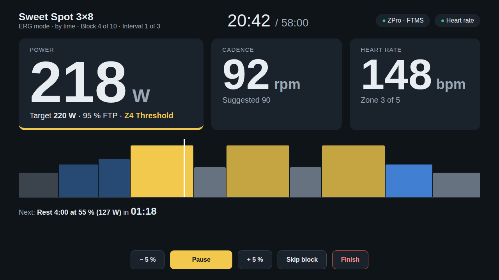
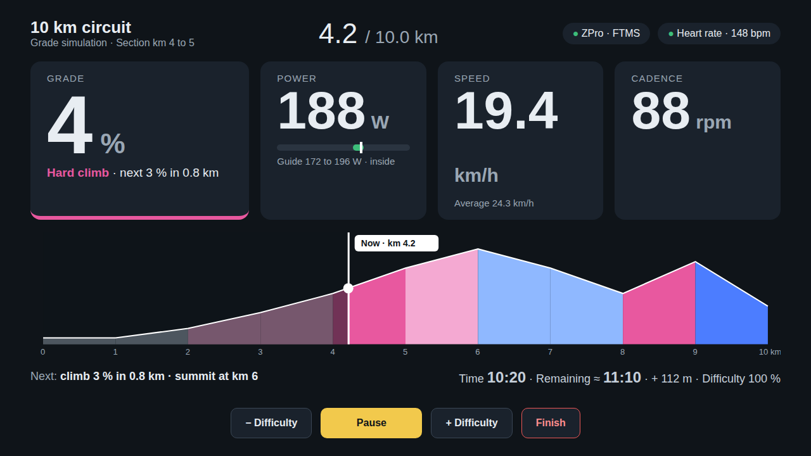
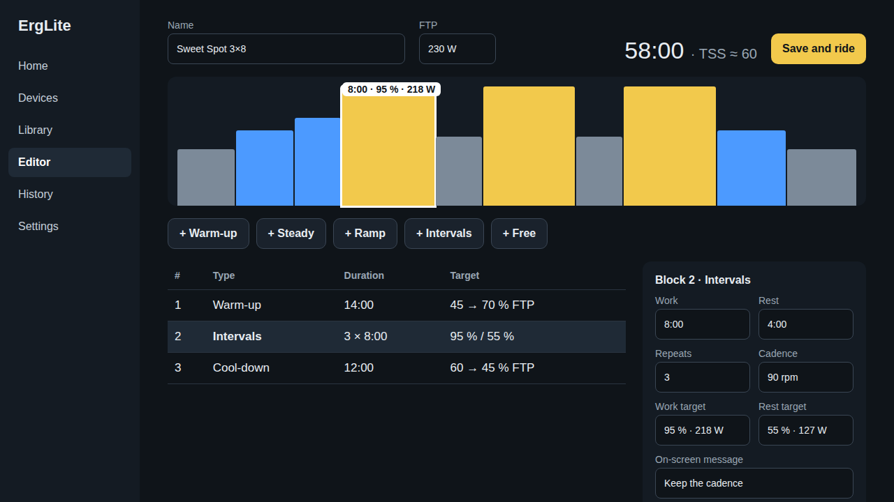
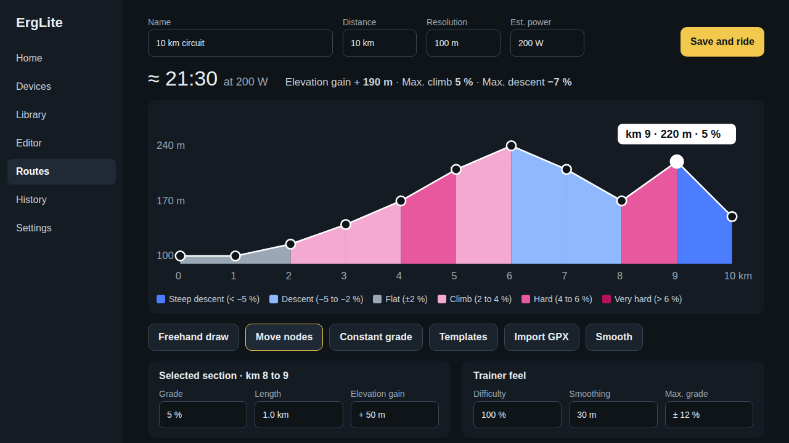
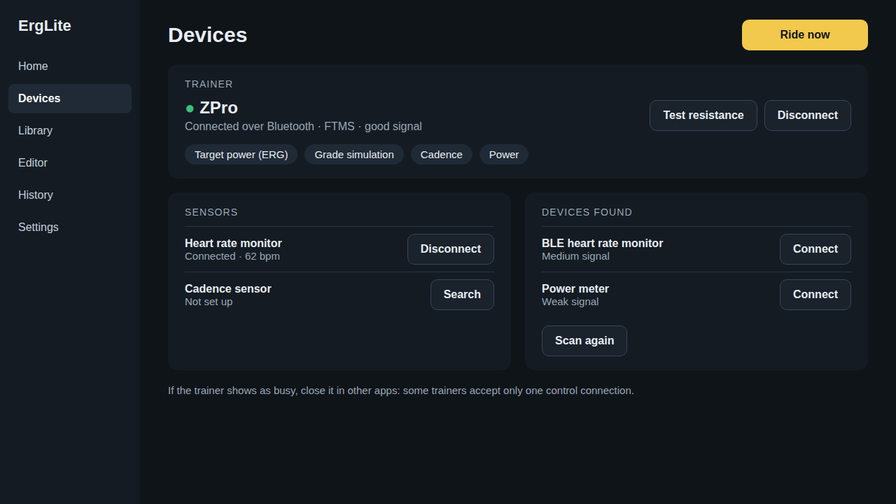

# ErgLite

Structured indoor cycling for smart trainers, **without a subscription**. Build interval workouts by
time and intensity (ERG mode) or ride a route you draw by distance and elevation (the trainer changes
its resistance with the grade). Everything stays on your computer in a local SQLite database: no
accounts, no cloud, no telemetry.

> **Working name.** "ErgLite" is provisional. The code is organized so that renaming the project is cheap.
> The first target device is the Zycle ZPro. Zycle and ZPro are trademarks of their owners; this project
> is not affiliated with them.

## Status

| Area | State |
|---|---|
| FTMS codec (`erglite-ftms`) | Done, unit and property tested |
| Workout engine: ERG segments, grade simulation, smoothing, pause, skip, intensity (`erglite-core`) | Done, tested |
| Physics estimator, NP / IF / TSS, zones | Done, tested |
| SQLite storage with migrations and crash recovery (`erglite-store`) | Done, tested |
| `.zwo` and GPX import, TCX export (`erglite-formats`) | Done, tested. FIT export is not implemented yet |
| Simulated trainer and session runner (`erglite-transport`, `erglite-runtime`) | Done, tested end to end |
| Bluetooth LE backend (`--features ble`) | **Compiles, not validated on real hardware** |
| User interface (`app/ui`) | Done: home, devices, library, workout editor, route editor, session (time and route), summary, history, settings, English and Spanish |
| Tauri shell (`app/src-tauri`) | Written against the Rust crates; see `docs/hardware-testing.md` before trusting it with a real trainer |
| ANT+ / FE-C | Not started (planned) |

Anything that depends on how a real trainer behaves is marked `HW-VERIFY` in the code and tracked in
[`docs/hardware-testing.md`](docs/hardware-testing.md).

## Interface

The UI is built with Svelte 5 and runs in the browser (for development) or as a Tauri desktop app.

| Screen | Description |
|---|---|
| **Session (Time)** | Structured ERG workout by time and intensity. Shows target power, cadence, heart rate, segment progress, and real-time metrics. |
| **Session (Route)** | Route-based ride where trainer resistance follows the grade profile. Elevation map, distance, and power targets adapt to the route. |
| **Workout Editor** | Visual builder for interval workouts. Add warm-up, steady, ramp, and interval blocks; drag to reorder; set duration and intensity (% FTP). |
| **Route Editor** | Draw routes by placing waypoints on a map. Elevation is sampled automatically; grade segments drive trainer resistance. |
| **Devices** | Scan for FTMS trainers over Bluetooth LE, connect/disconnect, view capabilities (ERG mode, simulation, cadence, power). |
| **Library** | Browse saved workouts and routes. Duplicate, edit, delete, or start a ride. |
| **History** | List of completed sessions with summary metrics (duration, avg power, TSS, NP, IF). Export to TCX. |
| **Settings** | Rider profile (FTP, weight, bike weight, max HR), physics (Crr, CdA), language (EN/ES), theme (dark/light), data location. |

### Screenshots

| Session (Time) | Session (Route) |
|---|---|
|  |  |

| Workout Editor | Route Editor |
|---|---|
|  |  |

| Devices |
|---|
|  |

## Quick start

Requirements: Rust (stable), Node.js 22+. On Linux the Bluetooth backend needs `libdbus-1-dev` and `pkg-config`.

```bash
# Core crates: tests and lints
cargo test --workspace
cargo clippy --workspace --all-targets -- -D warnings

# Simulate a workout against the built-in simulated trainer (accelerated time)
cargo run -p erglite-cli -- simulate fixtures/workouts/sweet-spot-3x8.json --ftp 250
cargo run -p erglite-cli -- simulate fixtures/workouts/rolling-10km.json --rider-power 200
cargo run -p erglite-cli -- estimate fixtures/workouts/rolling-10km.json --power 200

# UI in the browser (uses an in-browser mock engine, no trainer needed)
cd app/ui && npm install && npm run dev
npm run build:demo        # one self-contained HTML file in app/ui/dist

# Desktop app (needs the Tauri prerequisites for your OS)
cd app/src-tauri && cargo install tauri-cli --version "^2" --locked && cargo tauri dev
```

## Building the desktop app (erglite-app)

The Tauri shell lives in `app/src-tauri/` and is a standalone Cargo workspace.

### Prerequisites

- Rust stable (≥1.85)
- Node.js 22+
- Linux: `libdbus-1-dev`, `pkg-config`, `libwebkit2gtk-4.1-dev`, `libayatana-appindicator3-dev`, `librsvg2-dev`
- macOS: Xcode command line tools
- Windows: Visual Studio Build Tools + WebView2

### Development (hot reload)

```bash
cd app/src-tauri
cargo install tauri-cli --version "^2" --locked
cargo tauri dev
```

This starts the Vite dev server and the Tauri app with hot reload for both frontend and Rust code.

### Production build

```bash
cd app/src-tauri
cargo tauri build
```

This produces:
- Binary: `target/release/erglite-app` (self-contained, embeds the UI)
- Installers in `target/release/bundle/`:
  - Linux: `.deb`, `.rpm`, `.AppImage`
  - macOS: `.dmg`, `.app`
  - Windows: `.msi`, `.exe`

### Run the standalone binary

After `cargo tauri build` or `cargo build --release`:

```bash
./app/src-tauri/target/release/erglite-app
```

No dev server needed—the frontend is embedded in the binary.

## Repository layout

```
crates/
  erglite-core/        domain model, workout engine, physics, metrics (pure, no I/O)
  erglite-ftms/        Bluetooth FTMS codec (pure)
  erglite-transport/   TrainerBackend trait, simulated trainer, optional BLE backend
  erglite-store/       SQLite storage and migrations
  erglite-formats/     ZWO and GPX import, TCX export
  erglite-runtime/     session runner: engine + trainer + recorder
  erglite-cli/         simulate, estimate, scan
app/
  ui/                  Svelte 5 + TypeScript interface (browser mock + Tauri backends)
  src-tauri/           Tauri 2 shell (own Cargo workspace)
design/                interface reference: screens, tokens, component map
docs/                  architecture, compatibility matrix, hardware test plan, ADRs
fixtures/              sample workouts and routes
migrations/            SQL migrations embedded by erglite-store
```

## Documentation

- [Architecture](docs/architecture.md)
- [Hardware testing checklist](docs/hardware-testing.md)
- [Trainer compatibility](docs/compatibility.md)
- [Design reference](design/README.md)
- Full specification: see [`docs/README.md`](docs/README.md)

## License

Dual-licensed under [MIT](LICENSE-MIT) or [Apache-2.0](LICENSE-APACHE), at your option.
The UI bundles the Barlow typeface (SIL Open Font License 1.1).
